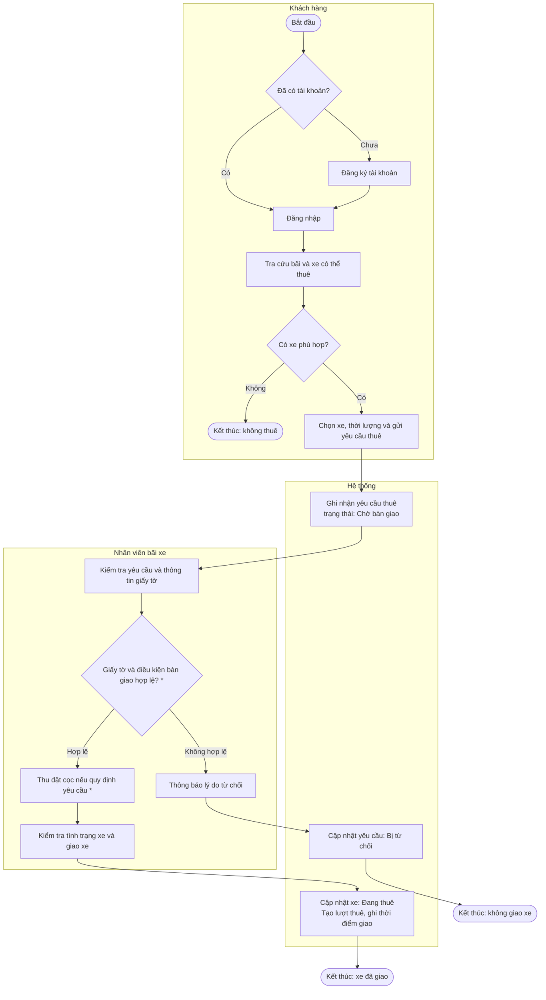
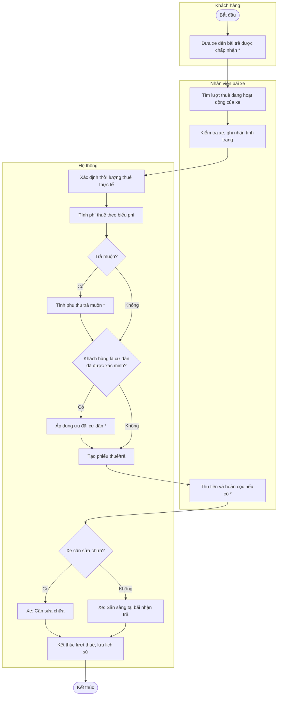
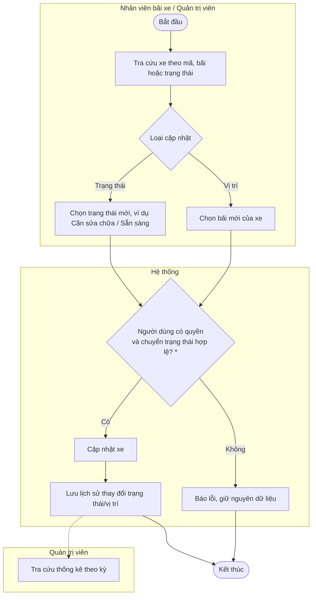

# CHƯƠNG 2. PHÂN TÍCH NGHIỆP VỤ

**Phiên bản:** v0.1 — 2026-10-21 · **Trạng thái:** Draft (bản gọn — chương tùy chọn)

## 2.1. Cơ cấu tổ chức (vai trò nghiệp vụ)

| Vai trò | Trách nhiệm nghiệp vụ |
|---|---|
| Khách hàng (Customer) | Tạo/quản lý tài khoản, tra cứu bãi và xe, gửi/hủy yêu cầu thuê, theo dõi lượt thuê đang diễn ra và lịch sử thuê |
| Cư dân Ecopark (Resident) | Là **khách hàng có hồ sơ cư dân**; thực hiện mọi thao tác như khách hàng; được xét ưu đãi khi hồ sơ cư dân được xác minh |
| Nhân viên bãi xe (Parking Staff) | Xử lý yêu cầu thuê thuộc bãi được phân công; kiểm tra giấy tờ/điều kiện; giao xe; tiếp nhận xe trả và ghi nhận tình trạng xe; cập nhật trạng thái xe |
| Quản trị viên / Điều hành (Administrator) | Quản lý bãi, xe, tài khoản và dữ liệu vận hành; xem thống kê (và báo cáo, nhật ký nếu được đưa vào phạm vi) |

**Ghi chú mô hình hóa [Đề xuất]:** "Cư dân" không được tạo thành tác nhân độc lập; đây là một *loại hồ sơ / nhóm quyền lợi* của Khách hàng (thuộc tính "trạng thái xác minh cư dân"). Lý do: cư dân không có thao tác nghiệp vụ riêng khác khách hàng, chỉ khác ở cách tính phí. Chờ thống nhất với thành viên 2 (Q-01).

Người xác minh hồ sơ cư dân (nhân viên hay quản trị viên) chưa được xác định (Q-08).

## 2.2. Quy trình nghiệp vụ

Các sơ đồ dưới đây là lưu đồ nghiệp vụ dạng swimlane, mỗi làn tương ứng một vai trò. Các bước/nhánh có ký hiệu **(\*)** phụ thuộc quy tắc chưa chốt, được giữ ở dạng điều kiện tổng quát và sẽ chỉnh khi nhóm trưởng xác nhận.

### Hình 2.1. Quy trình A — Thuê xe

Thuyết minh: Hình 2.1 mô tả từ khi khách hàng truy cập hệ thống tới khi xe được giao. Hai nhánh quan trọng là (1) không có xe phù hợp và (2) không đủ điều kiện bàn giao. Loại giấy tờ, việc thu đặt cọc và điều kiện từ chối chưa chốt (Q-04, Q-05). Khách hàng có thể hủy yêu cầu khi yêu cầu còn ở trạng thái *Chờ bàn giao* (FR-08) — nhánh này không vẽ để giữ sơ đồ dễ đọc.

### Hình 2.2. Quy trình B — Trả xe

Thuyết minh: Hệ thống xác định thời lượng thuê từ thời điểm giao và thời điểm trả do nhân viên ghi nhận, sau đó tính phí, phụ thu và ưu đãi. Vị trí hiện tại của xe được cập nhật thành bãi nhận trả. Các quy tắc tính phụ thu, ưu đãi, hoàn cọc và việc trả khác bãi chưa chốt (Q-05 → Q-09). Có thể cần thêm phí bồi thường hư hỏng — chưa được đề cập trong đề bài nên không đưa vào sơ đồ (Q-15).

### Hình 2.3. Quy trình C — Quản lý đội xe

Thuyết minh: Quy trình áp dụng khi cần ghi nhận xe hỏng, xe đã sửa xong hoặc điều chuyển xe giữa các bãi. Xe đang trong một lượt thuê không được chuyển sang trạng thái khác ngoài luồng trả xe (đề xuất BR-03, chờ xác nhận). Phạm vi bãi mà nhân viên được thao tác chưa chốt (Q-11). Dữ liệu lịch sử là đầu vào cho thống kê của quản trị viên.

## 2.3. Các lớp lĩnh vực (đối tượng nghiệp vụ)

Danh sách là đề xuất ban đầu, cần thống nhất tên với thành viên 3. Các đối tượng không nhất thiết tương ứng một-một với bảng CSDL hoặc lớp phần mềm.

| Đối tượng nghiệp vụ | Ý nghĩa |
|---|---|
| Khách hàng | Người sử dụng dịch vụ thuê xe, có tài khoản trong hệ thống |
| Hồ sơ cư dân | Thông tin dùng để xét điều kiện ưu đãi cư dân, gắn với một khách hàng, có trạng thái xác minh |
| Bãi xe | Địa điểm chứa và quản lý xe, có vị trí xác định |
| Xe đạp | Tài sản có mã định danh duy nhất, trạng thái và bãi hiện tại |
| Yêu cầu thuê | Yêu cầu do khách hàng gửi trước khi nhân viên bàn giao xe |
| Lượt thuê | Một phiên thuê từ lúc giao xe đến lúc trả xe |
| Biểu phí | Mức giá thuê, quy tắc phụ thu và ưu đãi đang áp dụng |
| Phiếu thuê/trả | Thông tin tổng kết lượt thuê và các khoản phí |
| Nhân viên | Người xử lý giao/nhận xe tại bãi được phân công |
| Quản trị viên | Người quản lý dữ liệu vận hành và xem thống kê |
| Nhật ký trạng thái xe | Lịch sử thay đổi trạng thái/vị trí xe |
| Báo cáo thống kê | Dữ liệu tổng hợp theo kỳ và tiêu chí quản lý |

Quan hệ nghiệp vụ chính (mức khái niệm):

- Một **Khách hàng** có thể có tối đa một **Hồ sơ cư dân**.
- Một **Khách hàng** gửi nhiều **Yêu cầu thuê**; một **Yêu cầu thuê** được bàn giao sẽ sinh ra một **Lượt thuê**.
- Một **Lượt thuê** gắn với một **Xe đạp**, một bãi giao, một bãi trả và một **Phiếu thuê/trả**.
- Một **Bãi xe** chứa nhiều **Xe đạp**; một **Nhân viên** được phân công cho một hoặc nhiều bãi (Q-11).
- Một **Xe đạp** có nhiều bản ghi **Nhật ký trạng thái xe**.
