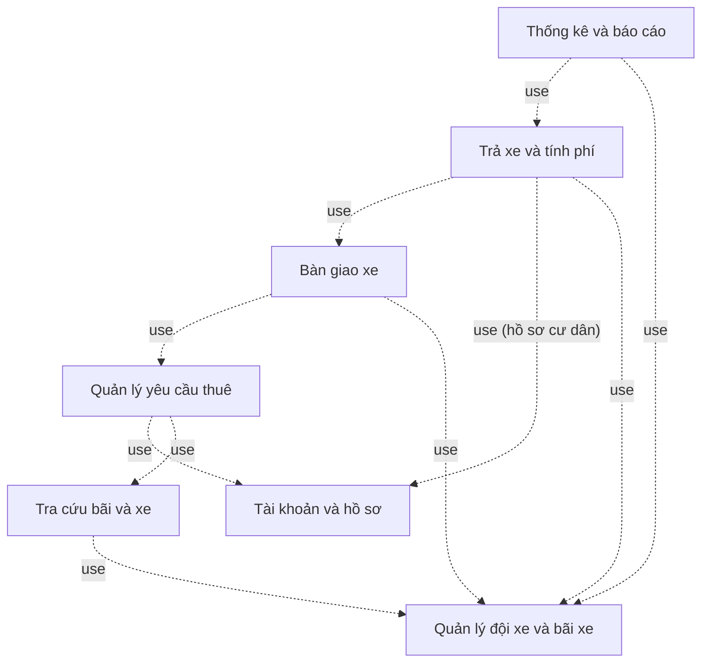

# M1-06a — Sơ đồ phân rã chức năng / Biểu đồ gói

**Phiên bản:** v0.1 — 2026-10-21 · **Trạng thái:** Draft

## Hình 3.1. Sơ đồ phân rã chức năng hệ thống Ecopark Bicycle Parking

Sơ đồ thể hiện **cấu trúc chức năng**, không thể hiện thứ tự thời gian. Mã FR trong ngoặc dùng để đối chiếu với [functional-requirements.md](functional-requirements.md). Khối viền nét đứt là chức năng đang chờ quyết định phạm vi.

```mermaid
flowchart TB
  ROOT["Hệ thống Ecopark Bicycle Parking"]

  ROOT --> G1["1. Quản lý tài khoản và hồ sơ"]
  ROOT --> G2["2. Tra cứu bãi và xe"]
  ROOT --> G3["3. Quản lý yêu cầu thuê"]
  ROOT --> G4["4. Bàn giao xe"]
  ROOT --> G5["5. Trả xe và tính phí"]
  ROOT --> G6["6. Quản lý đội xe và bãi xe"]
  ROOT --> G7["7. Thống kê và báo cáo"]

  G1 --> F01["1.1 Đăng ký / đăng nhập (FR-01)"]
  G1 --> F02["1.2 Xem / cập nhật hồ sơ (FR-02)"]
  G1 --> F03["1.3 Kiểm tra thông tin định danh (FR-03)"]
  G1 --> F24["1.4 Khai báo và xác minh hồ sơ cư dân (FR-24)"]
  G1 --> F20["1.5 Quản lý tài khoản (FR-20)"]

  G2 --> F04["2.1 Xem danh sách bãi (FR-04)"]
  G2 --> F05["2.2 Tìm bãi gần người dùng (FR-05)"]
  G2 --> F06["2.3 Xem / lọc xe khả dụng (FR-06)"]

  G3 --> F07["3.1 Gửi yêu cầu thuê (FR-07)"]
  G3 --> F08["3.2 Hủy yêu cầu thuê (FR-08)"]
  G3 --> F16["3.3 Xem lịch sử thuê (FR-16)"]

  G4 --> F09["4.1 Kiểm tra điều kiện bàn giao (FR-09)"]
  G4 --> F10["4.2 Ghi nhận bàn giao xe (FR-10)"]

  G5 --> F11["5.1 Ghi nhận trả xe (FR-11)"]
  G5 --> F12["5.2 Tính phí thuê (FR-12)"]
  G5 --> F13["5.3 Tính phụ thu trả muộn (FR-13)"]
  G5 --> F14["5.4 Áp dụng ưu đãi cư dân (FR-14)"]
  G5 --> F15["5.5 Tạo phiếu thuê/trả (FR-15)"]

  G6 --> F17["6.1 Tra cứu xe (FR-17)"]
  G6 --> F18["6.2 Cập nhật trạng thái / vị trí xe (FR-18)"]
  G6 --> F19["6.3 Quản lý bãi xe (FR-19)"]

  G7 --> F21["7.1 Thống kê theo kỳ (FR-21)"]
  G7 --> F22["7.2 Xuất báo cáo (FR-22)"]
  G7 --> F23["7.3 Nhật ký thay đổi (FR-23)"]

  classDef pending stroke-dasharray: 5 5;
  class F22,F23 pending;
```

## Hình 3.2. Biểu đồ gói chức năng (mức tổng quan)

Biểu đồ gói thể hiện các nhóm chức năng và phụ thuộc chính giữa chúng (gói phía trên sử dụng dữ liệu/dịch vụ của gói phía dưới).

Thuyết minh: gói *Quản lý đội xe và bãi xe* là nguồn dữ liệu chung về bãi và trạng thái xe cho các gói tra cứu, bàn giao và trả xe. Gói *Trả xe và tính phí* dùng hồ sơ cư dân từ gói *Tài khoản và hồ sơ* để xét ưu đãi. Gói *Thống kê và báo cáo* chỉ đọc dữ liệu lượt thuê và xe.
