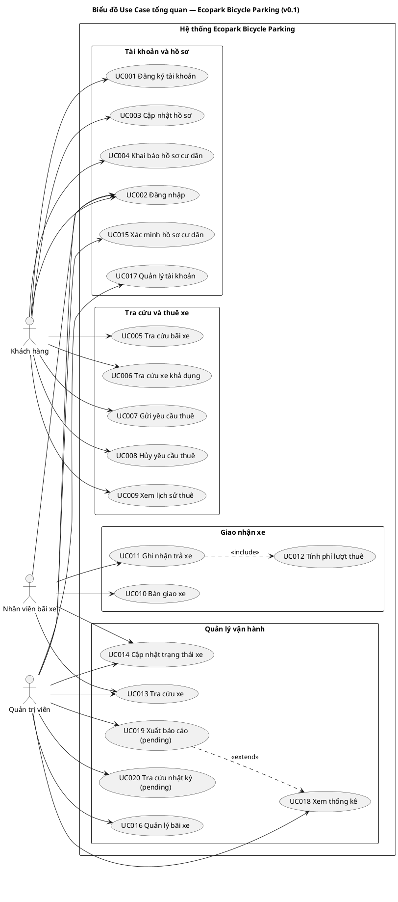
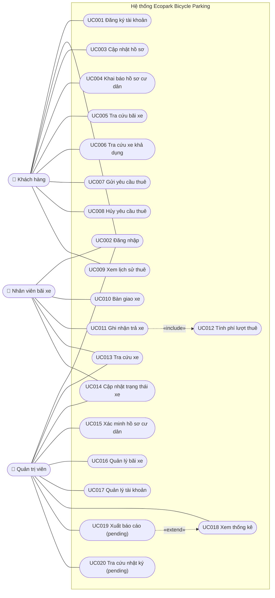

# M1-06b — Biểu đồ Use Case tổng quan

**Phiên bản:** v0.1 — 2026-10-21 · **Trạng thái:** Draft — chờ thống nhất với thành viên 2

> Tài liệu này chỉ gồm **biểu đồ tổng quan** và **ánh xạ sơ bộ FR → UC**. Đặc tả chi tiết từng Use Case (tiền/hậu điều kiện, luồng chính, luồng thay thế/ngoại lệ) do thành viên 2 phụ trách.

## 1. Tác nhân (Actor)

| Actor | Vai trò | Ghi chú |
|---|---|---|
| Khách hàng (Customer) | Sử dụng dịch vụ thuê xe | Cư dân **không** là actor riêng; là khách hàng có hồ sơ cư dân đã xác minh (đề xuất, Q-01) |
| Nhân viên bãi xe (Parking Staff) | Giao/nhận xe, cập nhật xe tại bãi được phân công | Phạm vi bãi: Q-11 |
| Quản trị viên (Administrator) | Quản lý bãi, xe, tài khoản; xem thống kê | |
| Dịch vụ bên ngoài | — | **Không thể hiện** ở v0.1 vì chưa có tương tác ngoài hệ thống được xác nhận (thanh toán trực tuyến, bản đồ/GPS, hệ thống cư dân đều đang ở Q-05, Q-10, Q-08) |

## 2. Danh sách Use Case đề xuất

Mã UC là đề xuất, cần thành viên 2 xác nhận trước khi dùng trong đặc tả.

| Mã UC | Tên Use Case | Actor chính | Gói chức năng |
|---|---|---|---|
| UC001 | Đăng ký tài khoản | Khách hàng | Tài khoản và hồ sơ |
| UC002 | Đăng nhập | Khách hàng, Nhân viên, Quản trị viên | Tài khoản và hồ sơ |
| UC003 | Cập nhật hồ sơ | Khách hàng | Tài khoản và hồ sơ |
| UC004 | Khai báo hồ sơ cư dân | Khách hàng | Tài khoản và hồ sơ |
| UC005 | Tra cứu bãi xe | Khách hàng | Tra cứu bãi và xe |
| UC006 | Tra cứu xe khả dụng | Khách hàng | Tra cứu bãi và xe |
| UC007 | Gửi yêu cầu thuê | Khách hàng | Quản lý yêu cầu thuê |
| UC008 | Hủy yêu cầu thuê | Khách hàng | Quản lý yêu cầu thuê |
| UC009 | Xem lịch sử thuê | Khách hàng | Quản lý yêu cầu thuê |
| UC010 | Bàn giao xe | Nhân viên | Bàn giao xe |
| UC011 | Ghi nhận trả xe | Nhân viên | Trả xe và tính phí |
| UC012 | Tính phí lượt thuê | (được include bởi UC011) | Trả xe và tính phí |
| UC013 | Tra cứu xe | Nhân viên, Quản trị viên | Quản lý đội xe và bãi xe |
| UC014 | Cập nhật trạng thái xe | Nhân viên, Quản trị viên | Quản lý đội xe và bãi xe |
| UC015 | Xác minh hồ sơ cư dân | Quản trị viên *(hoặc Nhân viên — Q-08)* | Tài khoản và hồ sơ |
| UC016 | Quản lý bãi xe | Quản trị viên | Quản lý đội xe và bãi xe |
| UC017 | Quản lý tài khoản | Quản trị viên | Tài khoản và hồ sơ |
| UC018 | Xem thống kê | Quản trị viên | Thống kê và báo cáo |
| UC019 | Xuất báo cáo | Quản trị viên | Thống kê và báo cáo — **Pending scope** |
| UC020 | Tra cứu nhật ký thay đổi | Quản trị viên | Thống kê và báo cáo — **Pending scope** |

## 3. Hình 3.3. Biểu đồ Use Case tổng quan

### 3.1. Bản PlantUML (dùng cho báo cáo)

> Bản này cần `plantuml.jar` hoặc PlantUML server để dựng. Nếu editor báo lỗi `plantuml.jar not found`, dùng bản Mermaid ở mục 3.2 để xem trước.

### 3.2. Bản Mermaid (xem nhanh trong VS Code / GitHub)

Thuyết minh: Khách hàng thực hiện nhóm UC tự phục vụ (tài khoản, tra cứu, thuê, lịch sử). Nhân viên bãi xe thực hiện giao/nhận xe và cập nhật xe. Quản trị viên quản lý dữ liệu vận hành. UC012 không do actor kích hoạt trực tiếp mà là một phần bắt buộc của UC011. Ưu đãi cư dân được xử lý bên trong UC012, dựa trên kết quả UC004/UC015.

## 4. Ánh xạ sơ bộ FR → UC

| FR | UC đề xuất |
|---|---|
| FR-01 | UC001, UC002 |
| FR-02 | UC003 |
| FR-03 | UC001, UC003 |
| FR-04 | UC005 |
| FR-05 | UC005 |
| FR-06 | UC006 |
| FR-07 | UC007 |
| FR-08 | UC008 |
| FR-09 | UC010 |
| FR-10 | UC010 |
| FR-11 | UC011 |
| FR-12 | UC012 |
| FR-13 | UC012 |
| FR-14 | UC012 |
| FR-15 | UC011, UC009 |
| FR-16 | UC009 |
| FR-17 | UC013 |
| FR-18 | UC014 |
| FR-19 | UC016 |
| FR-20 | UC017 |
| FR-21 | UC018 |
| FR-22 | UC019 (pending) |
| FR-23 | UC020 (pending) |
| FR-24 | UC004, UC015 |

Mọi FR đều có ít nhất một UC; mọi UC đều truy về ít nhất một FR.

## 5. Điểm cần thống nhất với thành viên 2

1. Bảng mã UC001 → UC020 ở trên (đặc biệt: có tách UC001/UC002 hay không).
2. Cư dân là thuộc tính của Khách hàng, không phải actor (Q-01).
3. UC012 là `<<include>>` của UC011 thay vì UC độc lập.
4. Có thể dùng tổng quát hóa actor (Quản trị viên kế thừa Nhân viên) hay không — phụ thuộc Q-11.
5. Khi thành viên 2 đề xuất UC mới, thành viên 1 sẽ bổ sung FR tương ứng.
