# Chương 4. Thiết kế hệ thống

Dự thảo thiết kế mục tiêu cho Ecopark Bicycle Parking. Các mã và luồng use case (UC) theo [bản đặc tả Thành viên 2](https://github.com/KietLe2504/Project_System_Design/blob/4d9c14bb19b76ef307252a23188248446794571f/member-2/use-case-specifications.md). Các quy tắc còn chờ xác nhận được ghi trong [Giả định và câu hỏi mở](design-assumptions.md).

## 4.1 Kiến trúc

### 4.1.1 Kiến trúc logic

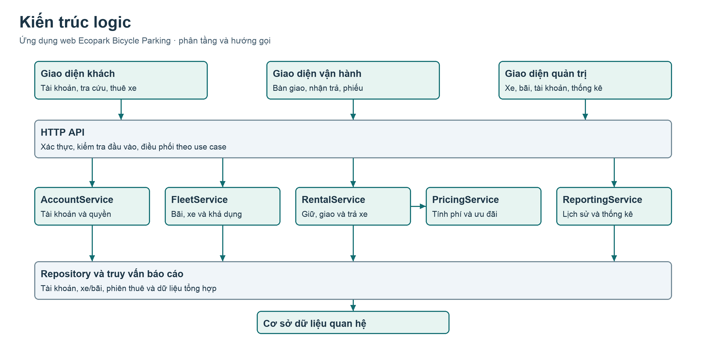

Hệ thống tổ chức theo ba tầng trong một ứng dụng web. Giao diện khách hàng hỗ trợ tài khoản, tra cứu xe và gửi yêu cầu thuê. Giao diện vận hành hỗ trợ giao và nhận xe, tra cứu phiếu. Giao diện quản trị hỗ trợ quản lý xe, bãi, tài khoản và thống kê. Ba giao diện gọi cùng tầng nghiệp vụ thông qua HTTP API.

Tầng nghiệp vụ gồm `AccountService` (tài khoản, hồ sơ, quyền và xác minh cư dân), `FleetService` (bãi, xe, khả dụng), `RentalService` (yêu cầu, giao xe, xác nhận trả và chốt trả), `PricingService` (tính phí), và `ReportingService` (lịch sử, thống kê và xuất báo cáo). `RentalService` điều phối giao dịch của một thao tác thuê hoặc trả. Nó nhận kết quả kiểm tra quyền từ mô-đun tài khoản, kiểm tra xe và bãi qua mô-đun đội xe, và dùng kết quả tính phí để lập phiếu. `PricingService` nhận dữ liệu đầu vào và trả các khoản tiền, còn việc lưu phiếu thuộc `RentalService`.

Tầng lưu trữ chứa các repository truy cập dữ liệu tài khoản, xe, bãi và thuê xe, cùng các truy vấn đọc cho báo cáo. Trong một thao tác ghi, repository sử dụng cùng kết nối và giao dịch do tầng nghiệp vụ mở. Truy vấn khả dụng chỉ trả xe tại bãi hoạt động có trạng thái hiển thị **Sẵn sàng**. Một xe còn sử dụng được nhưng có yêu cầu giữ còn hiệu lực hiển thị **Đã đặt**. Các thành phần dùng tên như trong biểu đồ để Thành viên 4 đối chiếu trách nhiệm khi cài đặt.

### 4.1.2 Kiến trúc triển khai

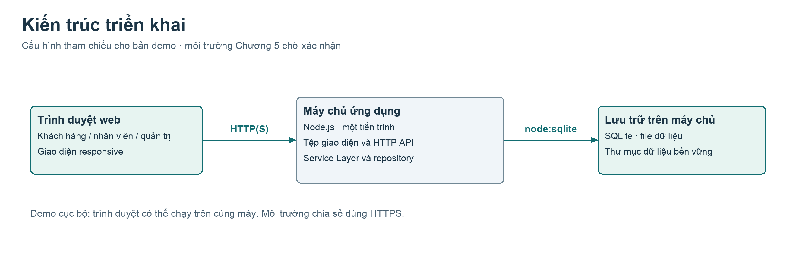

Cấu hình tham chiếu bám repo cũ đã đối chiếu. Trình duyệt sử dụng giao diện web responsive và gọi API cùng origin. Một tiến trình Node.js phục vụ giao diện và API. Cơ sở dữ liệu SQLite là file trên máy chủ ứng dụng, được truy cập qua thư viện trong cùng tiến trình. Khi chạy demo trên máy cá nhân, trình duyệt và máy chủ có thể cùng trên một máy. Môi trường chia sẻ cần HTTPS và thư mục dữ liệu bền vững cho file SQLite. Vị trí cài đặt, chế độ sao lưu và stack ở Chương 5 cần Thành viên 4 xác nhận.

Cấu hình này phù hợp với một máy chủ ghi SQLite. Khi thay đổi sang nhiều máy chủ ghi đồng thời, cần chọn lại cơ sở dữ liệu và cơ chế khóa, rồi kiểm tra lại bất biến giữ xe và sức chứa. Sơ đồ chỉ thể hiện các nút cần cho cấu hình demo. Các quyết định về ứng dụng mobile riêng, email thật và cổng thanh toán nằm trong danh sách câu hỏi mở.

## 4.2 Các kỹ thuật thiết kế

### 4.2.1 Giao diện

Các màn hình khách hàng và vận hành lấy trạng thái mới nhất từ API sau mỗi thao tác ghi. Giao diện phân biệt yêu cầu đang chờ nhận với lượt thuê đang diễn ra. Khi hai người chọn cùng xe hoặc trạng thái đã đổi, giao diện hiển thị lý do xung đột và tải lại thông tin xe. Việc đặt chỗ, bàn giao và chốt trả chỉ được hiển thị thành công sau khi máy chủ xác nhận giao dịch.

### 4.2.2 API và quy tắc nghiệp vụ

HTTP API xác thực người dùng và kiểm tra quyền trên từng tài nguyên. Khách chỉ đọc hoặc thay đổi dữ liệu thuê của mình. Thao tác giao và trả xe kiểm tra quyền của nhân viên tại bãi tương ứng theo cấu hình phân quyền. Tên thao tác trong biểu đồ là contract ở mức thiết kế. Body và đường dẫn chính thức do nhóm cài đặt chốt. Phản hồi lỗi phân biệt dữ liệu sai, thiếu quyền và xung đột trạng thái. Dữ liệu định danh đầy đủ chỉ đi qua chức năng cần kiểm tra và được giới hạn quyền đọc.

Thiết kế dùng Service Layer để gom điều kiện nghiệp vụ và điều phối giao dịch. Repository gom truy vấn, cập nhật có điều kiện và ánh xạ dữ liệu, giúp cùng một quy tắc được dùng cho giao diện khách và vận hành. `PricingService` dùng hàm tính phí độc lập với HTTP và cơ sở dữ liệu. Chi tiết phiếu lưu riêng phí cơ bản, phụ thu, giảm giá và tổng tiền để tra cứu lại theo thời điểm phát hành. Số tiền đặt cọc được theo dõi riêng.

UC012 nhận mốc bàn giao, mốc trả, dữ liệu tình trạng xe và biểu giá theo chính sách được duyệt. Phí cơ bản có thể gồm phí xe và phí theo thời gian thực tế theo Q-06. FR-14 xét trạng thái hồ sơ cư dân tại lúc tính phí. Mức giảm và khoản được giảm theo Q-08. Việc tính phụ thu muộn đang chờ giải quyết mâu thuẫn FR-13 và Q-07. Phí hư hỏng, thu và hoàn cọc tuân theo Q-15 và Q-05. Phí thuê và số tiền thực thu được ghi riêng nếu chính sách quy định đối trừ cọc.

### 4.2.3 Lưu trữ và giao dịch

Các thao tác cạnh tranh phải đọc lại điều kiện sau khi bắt đầu giao dịch ghi. Với SQLite, use case tạo yêu cầu, bàn giao và chốt trả dùng một giao dịch `BEGIN IMMEDIATE` bao quanh các kiểm tra có thể thay đổi và các lệnh ghi tương ứng. Trong phiên tạo yêu cầu, chuyển các yêu cầu đã quá giờ sang `expired` trước khi kiểm tra xe bị giữ. Ràng buộc duy nhất theo trạng thái bảo vệ thêm điều kiện một xe chỉ có một yêu cầu đang giữ và một lượt thuê đang diễn ra. Đổi xe, hủy yêu cầu và cập nhật trạng thái xe cũng đi qua cùng cơ chế đồng bộ.

Bàn giao thành công đánh dấu yêu cầu **Đã bàn giao**, tạo một lượt **Đang hoạt động**, chuyển xe sang **Đang thuê** và ghi kết quả xử lý cọc nếu áp dụng. Khi chốt trả, dịch vụ kiểm tra lại lượt thuê, quyền tại bãi, sức chứa nếu áp dụng, dữ liệu tính phí và điều kiện lập phiếu. Hệ thống lưu trạng thái lượt, vị trí và trạng thái xe, quyết định xử lý cọc cùng phiếu trong một lần commit. Ví dụ, lỗi khi ghi phiếu phải rollback cả lần cập nhật lượt và xe.

`request_id` là khóa nghiệp vụ chống bàn giao hai lần. `rental_id` là khóa nghiệp vụ chống lập hai phiếu cho cùng một lượt. Với yêu cầu gửi lại, dịch vụ chỉ trả kết quả đã lưu sau khi xác thực quyền và đối chiếu dữ liệu nghiệp vụ với lần ghi ban đầu. Trường hợp payload khác hoặc trạng thái không phù hợp trả về xung đột. Giao diện có thể tải lại kết quả theo mã yêu cầu hoặc mã lượt.

## 4.3 Thiết kế ca sử dụng

### 4.3.1 Biểu đồ lớp tổng hợp

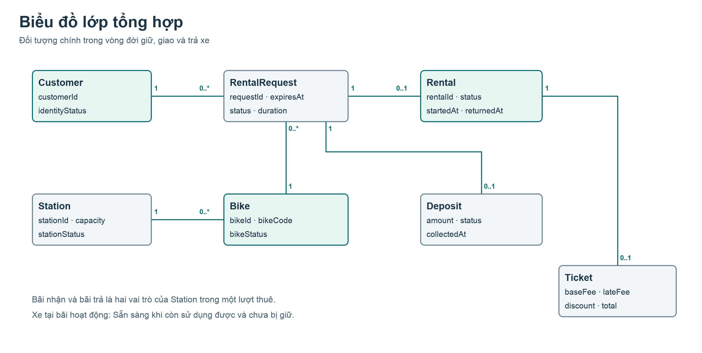

Một khách hàng có thể gửi nhiều `RentalRequest`. Mỗi yêu cầu hợp lệ tạo tối đa một `Rental` khi thực sự giao xe. Một xe có nhiều lượt thuê trong lịch sử. Cọc theo Q-05 gắn với yêu cầu để theo dõi được cả trường hợp hủy hoặc hết hạn trước bàn giao. Mỗi lượt thuê có tối đa một `Ticket`. `Station` quản lý vị trí đang ghi nhận của xe và tham gia vào giao dịch với vai trò bãi nhận hoặc trả. `Bike` giữ trạng thái vật lý. Xe còn `available` nhưng có yêu cầu giữ hiệu lực được chiếu thành **Đã đặt**. Trạng thái hiển thị này được suy ra từ cùng nguồn dữ liệu giữ xe.

### 4.3.2 UC007 — Gửi yêu cầu thuê

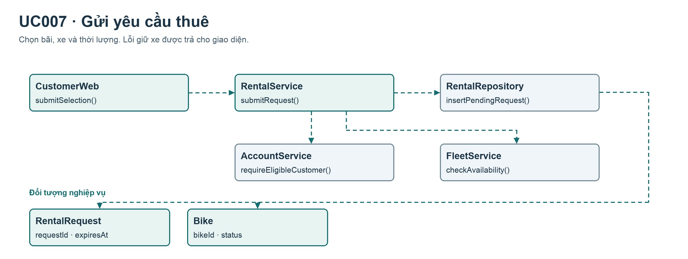

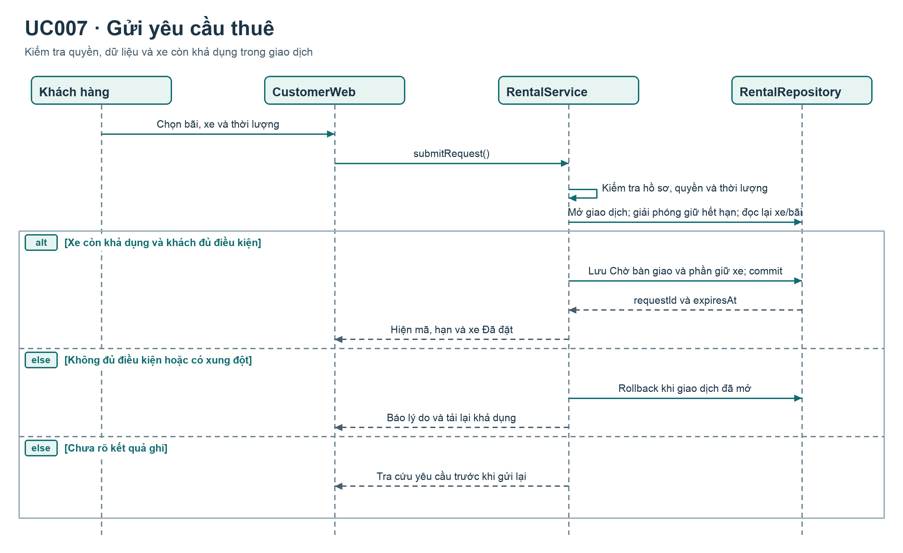

Khách chọn bãi, xe và thời lượng. `CustomerWeb` gửi dữ liệu cho `RentalService.submitRequest()`. Dịch vụ kiểm tra hồ sơ khách và thời lượng, rồi đọc lại xe, bãi và yêu cầu đang giữ trong giao dịch. Nếu xe còn khả dụng, `RentalRepository` lưu yêu cầu **Chờ bàn giao** và hạn giữ. Sau commit, xe hiển thị **Đã đặt**. Nếu xe đã bị giữ, dịch vụ trả kết quả xung đột để giao diện tải lại xe. Thời hạn giữ, giới hạn theo khách và đặt trước chờ Q-04. Điều kiện ghi nhận cọc lúc gửi chờ Q-05. Nếu chưa biết lệnh đã được lưu hay chưa, khách tra cứu yêu cầu hiện có trước khi gửi lại.

### 4.3.3 UC010 — Bàn giao xe

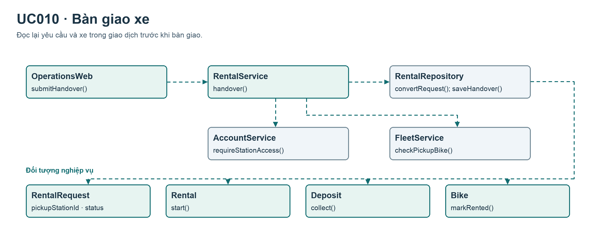

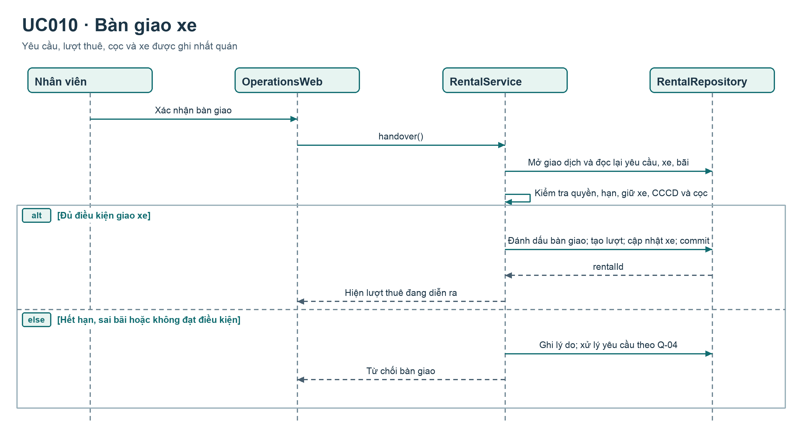

Nhân viên bãi xe chọn yêu cầu **Chờ bàn giao** và ghi kết quả kiểm tra. `OperationsWeb` gọi `RentalService.handover()`. Dịch vụ kiểm tra quyền tại bãi, thời hạn và phần giữ xe đúng yêu cầu, giấy tờ và cọc theo chính sách. Khi hợp lệ, dịch vụ chuyển yêu cầu sang **Đã bàn giao**, tạo lượt **Đang hoạt động** và cập nhật xe **Đang thuê** trong cùng giao dịch. Nếu điều kiện không đạt, ghi nhận lý do và áp dụng chính sách Q-04 về đóng yêu cầu và giải phóng xe. Đổi xe trước bàn giao cũng chờ Q-04.

### 4.3.4 UC011 — Ghi nhận trả xe

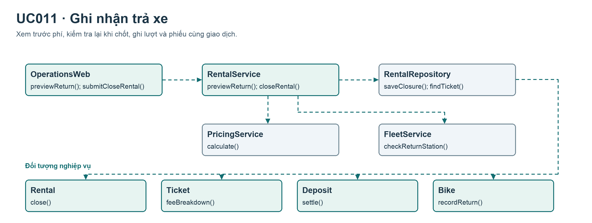

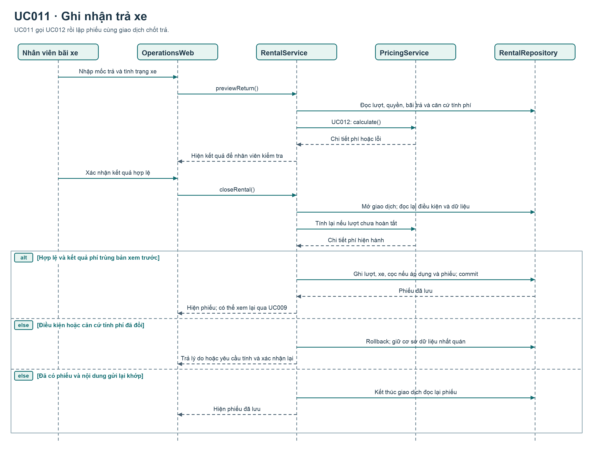

Nhân viên tra lượt đang hoạt động, kiểm tra quyền và điều kiện của bãi trả, rồi nhập mốc trả và tình trạng xe. UC011 gọi UC012 để xem trước các khoản và tính lại khi dữ liệu đổi. Khi nhân viên xác nhận, `RentalService.closeRental()` kiểm tra lại dữ liệu và căn cứ tính phí trong giao dịch. Nếu kết quả khác bản xem trước, trả kết quả mới để nhân viên xác nhận lại. Nếu hợp lệ, ghi đồng thời lượt **Đã hoàn tất**, vị trí/trạng thái xe, kết quả phí và cọc áp dụng cùng một phiếu theo FR-15. Phiếu đã lưu có thể xem lại qua UC009 nếu hiển thị ngay sau khi lưu gặp lỗi. Điều kiện trả khác bãi, sức chứa và xử lý xe hỏng theo Q-09 và Q-15.

### 4.3.5 UC012 — Tính phí lượt thuê

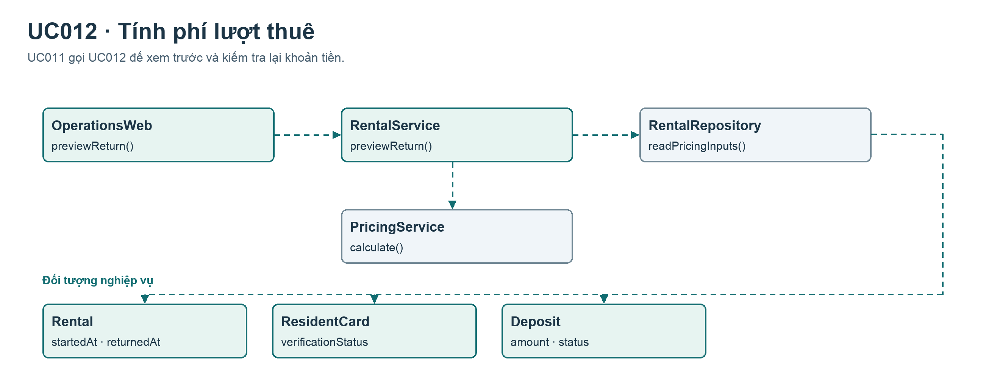

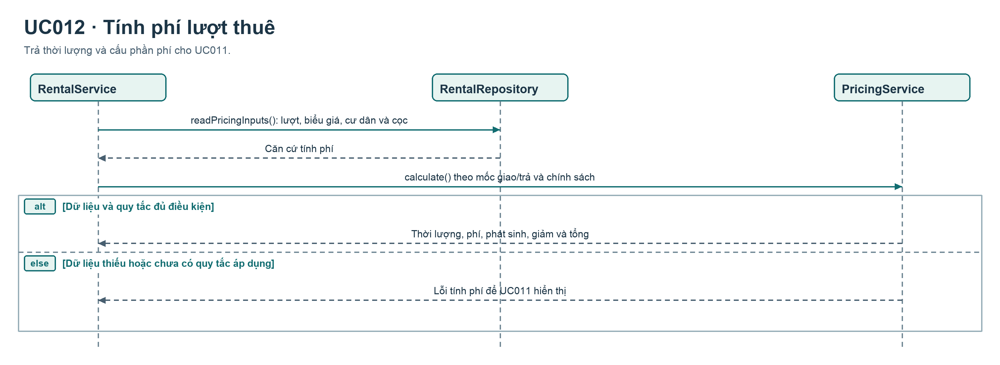

UC012 là ca sử dụng được UC011 gọi. `RentalService` lấy dữ liệu lượt thuê, thời điểm trả, biểu giá và căn cứ ưu đãi. `PricingService.calculate()` trả thời lượng thực tế và các cấu phần tiền hoặc lý do chưa tính được. Kết quả có thể dùng để xem trước và tái kiểm tra lúc hoàn tất. Việc lưu phiếu nằm trong giao dịch chốt trả của UC011.

### 4.3.6 Trạng thái và bàn giao dữ liệu

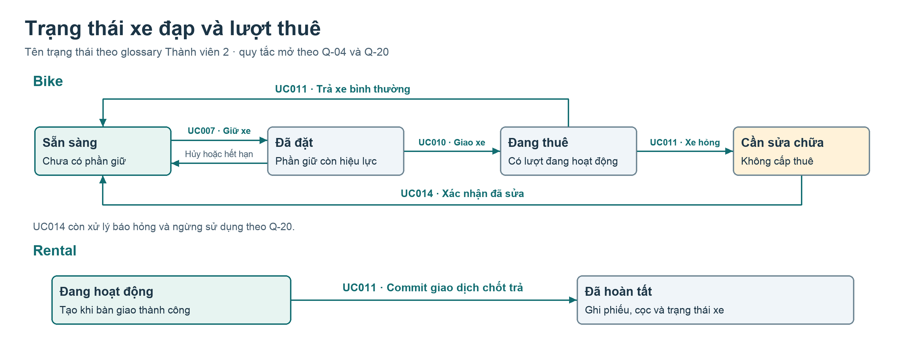

Theo glossary Thành viên 2, từ **Sẵn sàng**, xe thành **Đã đặt** tại UC007 và **Đang thuê** tại UC010. Hủy hoặc hết hạn giải phóng phần giữ. UC011 đưa xe về **Sẵn sàng** hoặc **Cần sửa chữa**. UC014 xử lý xe hỏng và khôi phục sau sửa. Trạng thái **Ngừng sử dụng** và quy tắc khôi phục chờ Q-20. Trạng thái yêu cầu gồm **Chờ bàn giao**, **Đã hủy**, **Hết hạn**, **Đã bàn giao** và **Bị từ chối** nếu Q-04 chốt. Lượt thuê chuyển từ **Đang hoạt động** sang **Đã hoàn tất** khi chốt trả thành công.

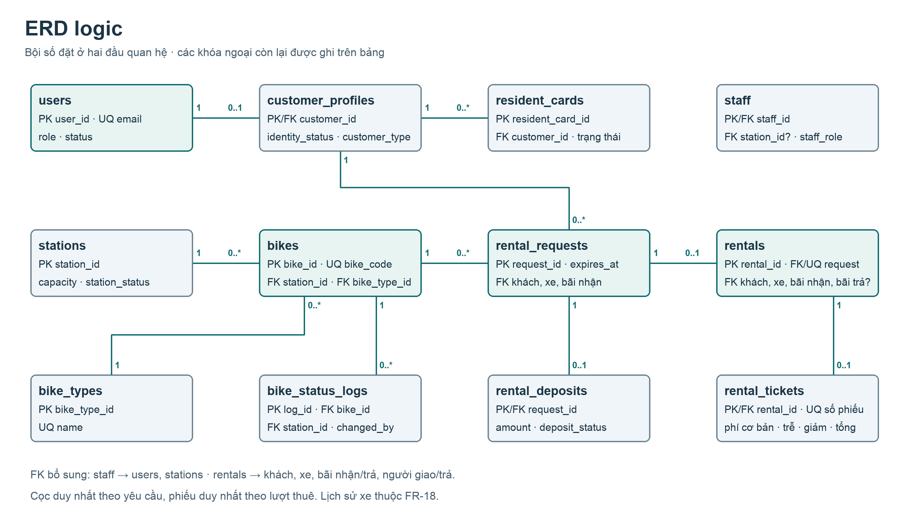

[Thiết kế cơ sở dữ liệu](database/database-design.md) mô tả cột, khóa, cardinality, chỉ mục và các ràng buộc liên bảng để Thành viên 4 tạo schema hoặc lập migration. [Bảng truy vết](uc-design-traceability.md) nối mã UC, chức năng và dữ liệu với các trách nhiệm ở Chương 4.
