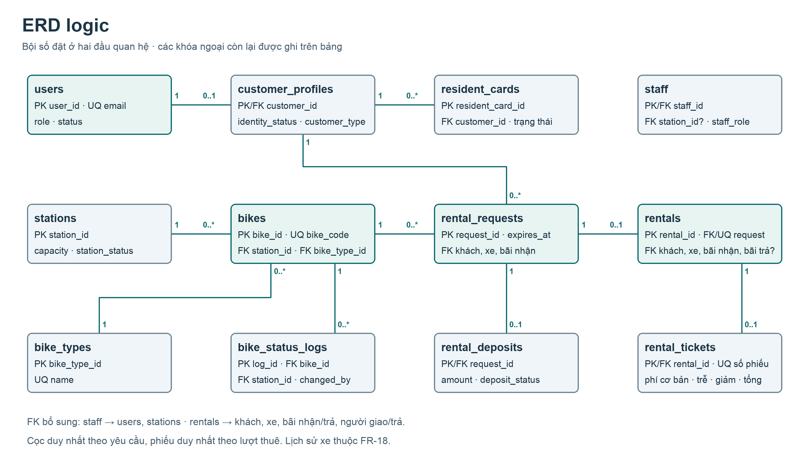

# Thiết kế cơ sở dữ liệu

ERD logic dự thảo để tạo schema cho bài Ecopark. Tên bảng bám cấu trúc repo nền khi tương đương. `PK` là khóa chính, `FK` là khóa ngoại, `UQ` là duy nhất. `?` chỉ trường có thể để trống. Bên triển khai cần ánh xạ schema đang dùng trước khi viết migration.

| Bảng | Cột chính | Ràng buộc và mục đích |
|---|---|---|
| `users` | `user_id PK`, `email`, `full_name`, `phone`, `password_hash`, `role`, `status`, `email_verified_at?` | Email chuẩn hóa và UQ. Vai trò customer/staff/admin. Lưu mật khẩu dưới dạng hash |
| `customer_profiles` | `customer_id PK/FK→users`, `identity_status`, `address?`, `identity_ref?`, `customer_type`, `active_resident_card_id?` | Một hồ sơ/khách. Dữ liệu đối chiếu giấy tờ theo Q-03. Nếu chọn thẻ hoạt động, thẻ phải thuộc cùng khách |
| `resident_cards` | `resident_card_id PK`, `customer_id FK`, `verification_status`, `verified_by? FK→users`, `verified_at?` | Khách có thể có lịch sử nhiều hồ sơ thẻ. Thông tin xét duyệt và thời điểm xác minh |
| `staff` | `staff_id PK/FK→users`, `station_id? FK`, `staff_role`, `active` | Hồ sơ vận hành. Kiểm tra quyền theo vai trò và bãi. Nếu nhóm chọn nhiều bãi/nhân viên thì cần bảng phân công |
| `stations` | `station_id PK`, `station_name`, `address`, `latitude`, `longitude`, `station_radius_meters`, `capacity`, `station_status` | Sức chứa không âm. Tọa độ theo đơn vị thống nhất. Tên/trạng thái phục vụ tra cứu và giao trả |
| `bike_types` | `bike_type_id PK`, `name UQ` | Danh mục loại xe |
| `bikes` | `bike_id PK`, `bike_code UQ`, `bike_type_id FK`, `station_id FK`, `bike_status`, `last_status_updated_at` | Mã xe duy nhất toàn hệ thống. Khi `rented`, `station_id` là bãi ghi nhận gần nhất, không tính xe này là đang đỗ |
| `rental_requests` | `request_id PK`, `customer_id FK`, `bike_id FK`, `pickup_station_id FK`, `requested_duration_minutes`, `request_status`, `created_at`, `expires_at` | Yêu cầu và lượt thuê là hai bản ghi. Tọa độ/khoảng cách chỉ lưu nếu chính sách yêu cầu. `expires_at > created_at` |
| `rentals` | `rental_id PK`, `request_id FK/UQ`, `customer_id FK`, `bike_id FK`, `pickup_station_id FK`, `return_station_id? FK`, `picked_up_by FK→users`, `returned_by? FK→users`, `planned_duration_minutes`, `started_at`, `return_confirmed_at?`, `returned_at?`, `rental_status` | Khách, xe, bãi nhận khớp yêu cầu khi bàn giao. Xác nhận trả có thể có bãi, vị trí và người xác nhận nếu được duyệt. Khi completed, các trường trả bắt buộc và thời điểm trả sau lúc giao |
| `rental_deposits` | `request_id PK/FK→rental_requests`, `amount`, `deposit_status`, `collected_at?`, `settled_at?`, `document_reference_masked?` | Tối đa một bản ghi cọc/yêu cầu trong mô hình hiện tại. Theo dõi được trước bàn giao, sau hủy hoặc hết hạn nếu Q-05 quy định. Lượt thuê truy được cọc qua `rentals.request_id` |
| `rental_tickets` | `rental_id PK/FK`, `ticket_no UQ`, `base_fee`, `late_fee?`, `other_charge?`, `resident_discount_amount`, `total_amount`, `issued_at` | Tối đa một phiếu/lượt. Các khoản không âm, giảm không vượt phí cơ bản, tổng tiền thuê = cơ bản − giảm + các khoản phát sinh được duyệt. Lưu cách đối trừ và số thực thu nếu Q-05 yêu cầu. Trường căn cứ tính và phiên bản biểu giá bổ sung nếu Q-06 chọn biểu giá phiên bản |
| `bike_status_logs` | `log_id PK`, `bike_id FK`, `station_id FK`, `changed_by FK→users`, `old_status`, `new_status`, `changed_at`, `reason?` | Lưu lịch sử trạng thái và vị trí theo FR-18. Nhật ký thao tác tổng quát chờ FR-23. Cập nhật vị trí có thể sinh dòng cùng trạng thái cũ/mới. Nhật ký ở cùng giao dịch thay đổi |

Thời điểm lưu UTC, dùng cùng định dạng để sắp xếp và so sánh. Báo cáo quy đổi vùng giờ nghiệp vụ trước khi lọc theo ngày, tuần, tháng theo khoảng nửa mở. Dùng số nguyên đồng cho các khoản tiền. Ở repo cũ, cọc chỉ gắn với `rental_id`. Nếu chọn phương án cọc trước bàn giao, migration cần nối cọc cũ về yêu cầu của lượt trước khi thêm khóa mới. Có thể giữ PK độc lập và dùng khóa duy nhất theo yêu cầu cho cọc hoặc theo lượt cho phiếu.

## Bất biến và xử lý đồng thời

- Tên trạng thái nghiệp vụ theo glossary. Các giá trị `available`, `rented`, `broken`, `pending_pickup` và `in_progress` là biểu diễn kỹ thuật tham chiếu. Suy ra **Đã đặt** từ xe còn sử dụng được và bản ghi giữ còn hiệu lực. Khi hết hạn, điều kiện hiển thị loại bản ghi hết hạn ngay, còn giao dịch ghi chuyển trạng thái yêu cầu để giải phóng chỉ mục giữ. Trạng thái ngừng sử dụng và từ chối phụ thuộc Q-20 và Q-04.

- Giữ xe bằng unique index có điều kiện trên `rental_requests(bike_id)` khi `request_status = 'pending_pickup'`. Chuyển các hàng đã quá hạn sang `expired` trong giao dịch trước khi thử giữ xe. Nếu quy tắc giới hạn theo khách được xác nhận, bổ sung chỉ mục theo `customer_id`.
- Dùng unique index có điều kiện trên `rentals(bike_id)` khi `rental_status = 'in_progress'`. `rentals.request_id` là unique để một yêu cầu chỉ chuyển thành một lượt. Giao dịch kiểm tra cả lịch giữ xe và lượt đang diễn ra để bảo vệ ràng buộc liên bảng.
- Quản lý sức chứa, nếu áp dụng, bằng cách đọc các xe thực tế chiếm chỗ tại bãi bên trong giao dịch chốt trả. Xe đang thuê không chiếm chỗ; áp dụng cách tính xe hỏng theo quy tắc nhóm duyệt.
- Sử dụng FK và bỏ qua cascade delete đối với tài khoản, xe và bãi đã có lịch sử nghiệp vụ. Vô hiệu hóa để ngừng hoạt động. Quy tắc lưu trữ hồ sơ nhạy cảm do nhóm xác nhận.
- Kiểm tra quyền và sở hữu khi đọc lịch sử, phiếu và căn cứ ưu đãi. Báo cáo mặc định chỉ tổng hợp, không lấy số giấy tờ hay tọa độ thô.
- Chỉ mục phục vụ truy vấn: `bikes(station_id, bike_status)`, `rental_requests(customer_id, request_status, expires_at)`, `rentals(customer_id, started_at)`, `rentals(bike_id, started_at)`, `rentals(returned_at, return_station_id)`. Báo cáo lượt và số tiền đã lập phiếu đọc `rentals` và `rental_tickets` qua `rental_id`. Thống kê mượn theo ngày dùng `started_at`, thống kê hoàn thành dùng `returned_at`, còn doanh thu phiếu dùng `issued_at`.

## Điều kiện kiểm thử cho Thành viên 4

| Tình huống | Kết quả cần kiểm tra |
|---|---|
| Hai khách cùng giữ một xe | Chỉ một yêu cầu còn giữ xe sau các giao dịch cạnh tranh |
| Xe đã giữ, yêu cầu vừa hết hạn | Giao dịch giải phóng giữ cũ, một khách đủ điều kiện có thể giữ lại |
| Hai người bàn giao cùng mã yêu cầu | Chỉ một lượt, một cọc; xe chuyển sang rented một lần |
| Hai xe cùng trả vào chỗ trống cuối cùng | Nếu giới hạn sức chứa được bật, chỉ một giao dịch chốt thành công |
| Lỗi giả lập khi ghi phiếu | Lượt, xe và cọc không có thay đổi dở dang |
| Gửi lại lệnh sau khi mất phản hồi | Cùng kết quả nếu cùng nội dung và đúng quyền; payload xung đột bị từ chối |
| Tra cứu qua mốc đầu tuần và cuối tháng | Đếm mỗi lượt đúng một kỳ theo vùng giờ báo cáo |
